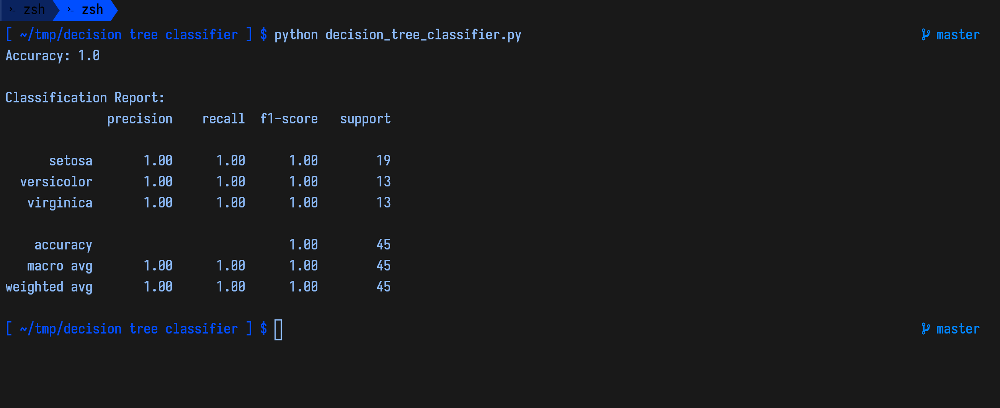

# decision-tree-classifier
decision tree classifiers are awesome and scary. 

A Decision Tree Classifier is a machine learning algorithm used for classification tasks. It models decisions and their possible consequences as a tree structure. Each internal node of the tree represents a "test" on an attribute (e.g., whether a coin flip is heads or tails), each branch represents the outcome of the test, and each leaf node represents a class label (decision taken after computing all attributes). The paths from root to leaf represent classification rules.
Essentially, it works by repeatedly splitting the dataset into separate branches based on the attributes in a way that each branch moves towards a decision of classifying the data into a distinct category. It's popular due to its simplicity, interpretability, and effectiveness for a wide range of data.

