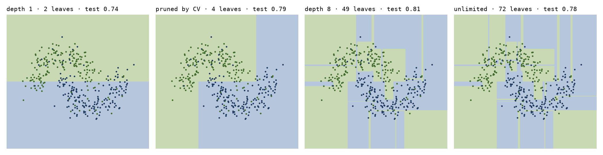

# happy-little-trees

**When does a decision tree stop learning and start painting every accident?**

> "We don't make mistakes, just happy accidents." — Bob Ross

A decision tree takes that literally. Give it enough depth and it will paint
a little region around every accident in the data, then present the result
as a masterpiece.

In November 2023 my decision-tree script scored **100 %** on the Iris dataset,
printed the report and stopped. The README called decision trees "awesome and
scary". I was pleased.


*November 2023. Forty-five test flowers, forty-five right. Perfect scores are
the scary part.*

It also taught me nothing, because Iris is too polite to overfit. This repo
gives the tree a canvas with real accidents on it: two interleaved half-moons,
a little smudged, with **10 % of labels flipped on purpose**. No model can
honestly beat ~90 % here. Anything above that is memory, not skill.


## The canvases



| tree | leaves | train | test |
|---|---:|---:|---:|
| depth 1 | 2 | 0.794 | 0.742 |
| depth 2 | 4 | 0.858 | 0.787 |
| depth 8 | 49 | 0.953 | 0.812 |
| unlimited | 72 | **1.000** | 0.783 |
| **pruned (ccp α = 0.0129, chosen by 5-fold CV)** | **4** | 0.858 | **0.787** |

## What the paint says

- **Training accuracy is a liar with a perfect score.** The unlimited tree is
  right about every training point and wrong about one test point in five.
  The 23 leaves it grows past depth 8 are portraits of individual flipped labels.
- **The test curve barely moves.** After depth 2 it wanders between 0.77 and
  0.81 while the leaf count grows 18×. Depth 8 edges ahead on this split,
  which is exactly the kind of win that disappears with a different seed.
- **The palette knife is the honest tool.** Cost-complexity pruning, with its
  strength picked by cross-validation on training data only, cuts the tree to
  **4 leaves**. It matches the 72-leaf tree's test score and is an object a
  person can read, check and put on a microcontroller.

Fewer leaves, same picture. If a model has to be explained to a robot's
safety reviewer, it had better fit on a napkin.

## The napkin

So here it is, on a napkin. `python -m happytrees.export` writes the
CV-pruned tree as a C function: no Python, no NumPy, no model file. It drops
straight into an Arduino sketch.

```c
/* 4 leaves, depth 2; generated by happytrees.export */
static inline int predict(const float *x) {
    if (x[1] <= 0.247126482f) {
        if (x[0] <= -0.487924725f) {
            return 0;
        } else {
            return 1;
        }
    } else {
        if (x[0] <= 1.53083217f) {
            return 0;
        } else {
            return 1;
        }
    }
}
```

`tests/test_export.py` compiles the generated C with gcc and checks it
agrees with scikit-learn on all 600 points, for trees of depth 2, 4 and
unlimited. An exporter that's *almost* right is a bug with good manners.

## Run it

```bash
python -m venv .venv && . .venv/bin/activate
pip install -r requirements.txt
python -m happytrees.run      # ~2 s, prints the table, rewrites assets/*.png
python -m happytrees.export   # the pruned tree, as C
pytest -q                     # the C and the Python agree, point for point
```

## Layout

```
origin/decision_tree_classifier.py   the 2023 script (Iris, 100 %, done)
README-2023.md                       "awesome and scary", with the screenshot
happytrees/run.py                    depth sweep, canvases, pruning by CV
happytrees/export.py                 tree → C
tests/test_export.py                 compiled-C equivalence
```
