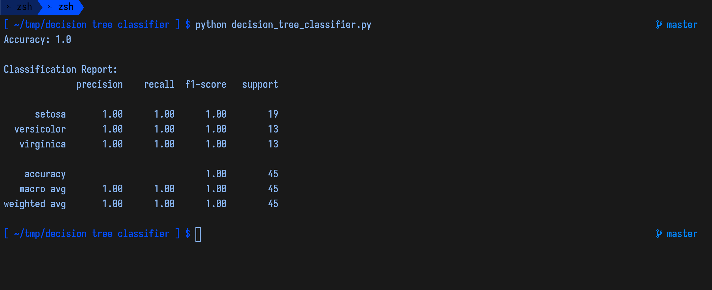
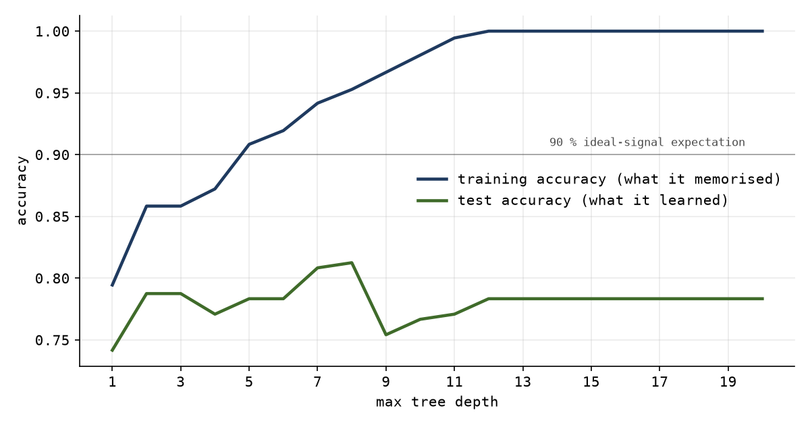

# happy-little-trees

**When does a decision tree stop learning and start painting every accident?**

> "We don't make mistakes, just happy accidents." — Bob Ross

A decision tree takes that literally. Give it enough depth and it will paint
a little region around every accident in the data, then present the result
as a masterpiece.

In November 2023 my decision-tree script scored **100 %** on the Iris dataset,
printed the report and stopped. The README called decision trees "awesome and
scary". I was pleased.



*November 2023. Forty-five test flowers, forty-five right. A real result on
one split, not a study of model complexity or sensitivity to different data.*

The later study asks a different question. `make_moons` generates 600 points
with coordinate noise 0.20; each binary label is then flipped independently
with probability 0.10. Seed 11 fixes the generator, noise draw and 60/40 split.
The result is 360 training points and 240 test points.

**Correction:** 10% label-flip probability does not impose a hard 90% ceiling
on a finite test score. The realised draw flips 36 training labels and 31 test
labels: 67 of 600 overall, not exactly 10% of every split.

For an independently evaluated predictor, symmetric binary noise gives
`expected noisy-label accuracy = 0.10 + 0.80 × clean-label accuracy`.
The two cases are a correct clean answer surviving a flip-free label, and an
incorrect clean answer agreeing after a flip. A perfect clean-label rule
would therefore score 90% **in expectation**, not in every sample.

On this particular test set, the generator's clean labels agree with its
corrupted labels on 209/240 points, or 87.08%. That is a diagnostic using the
synthetic generator's latent labels, not an achieved classifier score or a
new empirical ceiling. The perturbed, overlapping coordinates also make a
perfect clean-label rule an idealisation. The plot's thin 90% line is labelled
as an ideal-signal expectation, not a cheating detector.



## The canvases


| tree | leaves | train | test |
|---|---:|---:|---:|
| depth 1 | 2 | 0.794 | 0.742 |
| depth 2 | 4 | 0.858 | 0.787 |
| depth 8 | 49 | 0.953 | 0.812 |
| unlimited | 72 | **1.000** | 0.783 |
| **pruned (ccp α = 0.0129, chosen by 5-fold CV)** | **4** | 0.858 | **0.787** |

## What the paint says

- **Training fit is not generalisation.** The unlimited tree gets all 360
  training points right but only 188/240 test points. Its 72 leaves give it
  more flexibility; their number does not establish which leaves isolate
  corrupted labels rather than genuine local structure.
- **The apparent differences are small.** Depth 8 gets 195 test points right,
  the pruned tree 189, and the unlimited tree 188. This single split does not
  establish a ranking across other seeds or acquisition conditions.
- **Pruning makes the tradeoff inspectable.** Training-only five-fold CV
  chooses `ccp_alpha ≈ 0.0129`, leaving four leaves. It gets one more held-out
  point right than the 72-leaf tree here. That is a measured tradeoff, not a
  claim that four leaves is universally optimal.

Fewer leaves, same picture. If a model has to be explained to a robot's
safety reviewer, it had better fit on a napkin.

## The napkin

So here it is, on a napkin. `python -m happytrees.export` writes the
CV-pruned tree as a C function: no Python, NumPy or model loader in the
generated inference function. It is an embedded-inference example, not a
claim of Arduino deployment, hardware timing or safety certification.

```c
/* 4 leaves, depth 2; generated by happytrees.export */
static inline int predict(const float *x) {
    if (x[1] <= 0.247126482f) {
        if (x[0] <= -0.487924725f) {
            return 0;
        } else {
            return 1;
        }
    } else {
        if (x[0] <= 1.53083217f) {
            return 0;
        } else {
            return 1;
        }
    }
}
```

`tests/test_export.py` compiles the generated C with gcc and checks it
agrees with scikit-learn on all 600 points, for trees of depth 2, 4 and
unlimited. This is compiler-backed evidence on those inputs, not a proof
for every floating-point threshold, missing value or possible classifier.
An exporter that's *almost* right is a bug with good manners.

## What the tree optimises

Each internal node chooses one coordinate and a threshold: an axis-aligned
cut. Repeated cuts approximate a crescent with a staircase, but can also
isolate an inconvenient training point. The default Gini impurity is
`1 - sum(p_class ** 2)`; candidate splits minimise the sample-weighted
impurity of their children. This is greedy local optimisation, not a search
over all possible complete trees.

Minimal cost-complexity pruning trades off leaf impurity and complexity:

```text
cost(T) = R(T) + alpha * number_of_leaves(T)
```

Here `R(T)` is the total sample-weighted impurity of the terminal nodes,
following scikit-learn's definition—not held-out error. The full training
tree supplies candidate pruning strengths; the script excludes the final
root-only candidate, chooses the first best five-fold mean accuracy, and
refits on the complete training set.

The candidate path is built before the CV folds, so those scores are a
model-selection aid, not a nested, unbiased evaluation. Test labels do not
select the pruning strength. Conversely, choosing depth 8 after inspecting
the depth-sweep test curve would reuse that holdout for development; a fresh
final test would then be required.

For a sensor deployment, session/device-separated data and threshold-boundary
checks would be important next experiments. Neither is claimed by this
synthetic study.

### Read further

- [Decision trees: splitting, Gini impurity and implementation details](https://scikit-learn.org/stable/modules/tree.html)
- [Minimal cost-complexity pruning and the impurity-based objective](https://scikit-learn.org/stable/modules/tree.html#minimal-cost-complexity-pruning)

## Run it

```bash
python -m venv .venv && . .venv/bin/activate
pip install -r requirements.txt
python -m happytrees.run      # ~2 s, prints the table, rewrites assets/*.png
python -m happytrees.export   # the pruned tree, as C
pytest -q                     # the C and the Python agree, point for point
```

To inspect the realised label noise without fitting a model:

```bash
python - <<'PY'
import numpy as np
from sklearn.datasets import make_moons
from sklearn.model_selection import train_test_split
from happytrees.run import SEED, data

X, clean = make_moons(n_samples=600, noise=0.20, random_state=SEED)
flipped = np.random.default_rng(SEED).random(len(clean)) < 0.10
training, test = train_test_split(np.arange(len(clean)), test_size=0.4, random_state=SEED)
Xtr, Xte, ytr, yte = data()
assert np.array_equal(Xte, X[test])
assert np.array_equal(yte, np.where(flipped, 1 - clean, clean)[test])
print("flips (training, test, total):", *(int(flipped[i].sum()) for i in (training, test)), int(flipped.sum()))
print("clean-label test agreement:", int((clean[test] == yte).sum()), "/", len(test))
PY
```

With the preserved seed, this prints `36 31 67` flipped labels and `209 / 240`
clean-label agreement. These diagnose the noise draw; they are not model scores.

## Layout

```
origin/decision_tree_classifier.py   the 2023 script (Iris, 100 %, done)
README-2023.md                       "awesome and scary", with the screenshot
happytrees/run.py                    depth sweep, canvases, pruning by CV
happytrees/export.py                 tree → C
tests/test_export.py                 compiled-C equivalence
```
